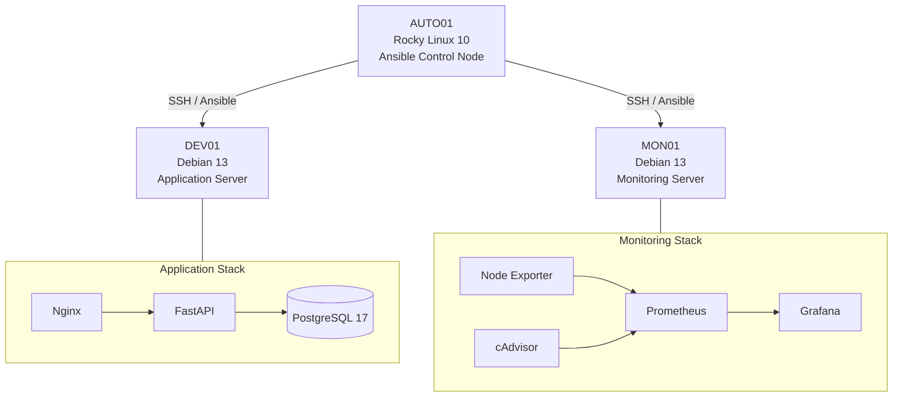

# DevOps Home Lab

A multi-server DevOps home lab demonstrating containerization, infrastructure automation, monitoring, and application deployment.

The project is built to practice real-world DevOps workflows and demonstrate how application infrastructure can be deployed, managed, and monitored.

## Architecture

The infrastructure consists of three virtual machines running on a private network.



## Infrastructure

| VM | Operating System | IP Address | Role |
|---|---|---|---|
| DEV01 | Debian 13 | 172.16.10.10 | Application Server |
| MON01 | Debian 13 | 172.16.10.20 | Monitoring Server |
| AUTO01 | Rocky Linux 10 | 172.16.10.30 | Ansible Control Node |

All virtual machines are connected through a private host-only network and have separate NAT connectivity for internet access.

## Technology Stack

### Application
- **Python / FastAPI** — REST API
- **PostgreSQL 17** — relational database
- **Nginx** — reverse proxy and web server
- **Docker** — containerization
- **Docker Compose** — multi-container application management

### Monitoring
- **Prometheus** — metrics collection and storage
- **Grafana** — monitoring dashboards
- **Node Exporter** — host-level metrics
- **cAdvisor** — container metrics

### Infrastructure Automation
- **Ansible** — configuration management and deployment
- **Ansible Roles** — reusable infrastructure components
- **Ansible Playbooks** — automated infrastructure operations
- **Git** — version control

## Repository Structure

```text
devops-home-lab/
├── ansible/
│   ├── inventory/
│   ├── playbooks/
│   ├── roles/
│   ├── ansible.cfg
│   ├── requirements.yml
│   ├── site.yml
│   └── README.md
├── backend/
│   ├── app/
│   ├── Dockerfile
│   └── requirements.txt
├── database/
│   └── init/
├── monitoring/
│   ├── prometheus/
│   └── compose.yml
├── nginx/
│   ├── conf.d/
│   ├── html/
│   └── Dockerfile
├── compose.yaml
└── README.md
```

## Network Services

| Service | Address | Purpose |
|---|---|---|
| Application | `http://172.16.10.10:8080` | Web application |
| API Health | `http://172.16.10.10:8080/api/health` | Application health check |
| Prometheus | `http://172.16.10.20:9090` | Metrics and queries |
| Grafana | `http://172.16.10.20:3000` | Monitoring dashboards |
| cAdvisor | `http://172.16.10.20:8081` | Container metrics |
| Node Exporter | `http://172.16.10.20:9100/metrics` | Host metrics |

These addresses are intended for access from the lab's private network.

## Deployment

### Application

The application stack is managed with Docker Compose.

From the project root on DEV01:

```bash
docker compose up -d
```

Check running containers:

```bash
docker compose ps
```

### Monitoring

From the monitoring directory on MON01:

```bash
cd monitoring
docker compose up -d
```

### Ansible Automation

Ansible is used to automate infrastructure configuration, application deployment, and service startup.

Install required collections:

```bash
cd ansible
ansible-galaxy collection install -r requirements.yml
```

Check connectivity:

```bash
ansible all -m ping
```

Run the complete infrastructure deployment:

```bash
ansible-playbook site.yml
```

Run individual playbooks:

```bash
ansible-playbook playbooks/system-info.yml
ansible-playbook playbooks/system-maintenance.yml
ansible-playbook playbooks/docker-setup.yml
ansible-playbook playbooks/deploy-infrastructure.yml
ansible-playbook playbooks/start-infrastructure.yml
```

Pull nginx and backend from GHCR and recreate only those containers. Postgres, its volume, and the monitoring stack stay as they are. `latest` is the default tag. A commit SHA published by CI can be passed explicitly. On a push to `main`, the self-hosted runner on AUTO01 runs this after the image build, passing the commit SHA as `image_tag`. The same command can still be run by hand. If the GHCR packages are private, pass `ghcr_user` and `ghcr_token` as extra vars. Do not store the token in the repository.

```bash
ansible-playbook playbooks/deploy-app.yml
ansible-playbook playbooks/deploy-app.yml -e image_tag=<git-sha>
```

For additional Ansible configuration and deployment details, see [Ansible README](ansible/README.md).

## Infrastructure Automation Features

The Ansible project includes:

- Automated Docker installation and configuration.
- Application and monitoring deployment.
- Reusable roles for Docker, application, and monitoring.
- System information gathering.
- System maintenance and package updates.
- Service health checks.
- Idempotent playbook execution.

## Security Considerations

- Sensitive environment variables are not committed to Git.
- SSH authentication is used for Ansible connections.
- Ansible privilege escalation is configured through sudo.
- Private keys and credentials must remain outside the repository.
- Services are intended for a private lab network.

## Project Goals

This project is an ongoing practical learning environment focused on:

- Linux server administration.
- Containerization and orchestration fundamentals.
- Infrastructure as Code.
- Configuration management.
- Monitoring and observability.
- Networking fundamentals.
- Version control and automation workflows.

## Future Improvements

Planned development:

- Terraform infrastructure provisioning.
- Kubernetes cluster deployment.
- Automated Ansible linting and validation.
- Expanded monitoring and alerting.
- Centralized logging.

---

**Status:** Active development.

**Purpose:** Practical DevOps engineering portfolio project.
